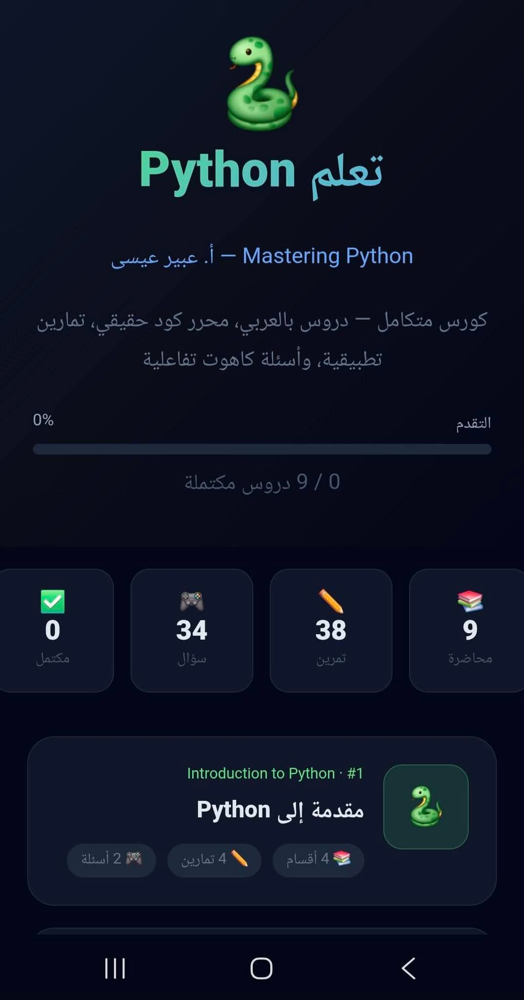
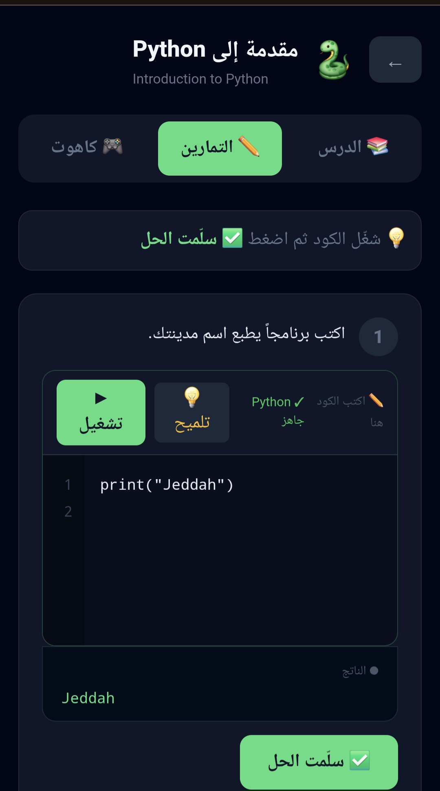

Interactive Python Learning Platform 🐍

An interactive educational application designed and developed by Abeer Eissa, a Computer Science Lecturer and Python Programming Trainer.

Project Overview

This platform helps beginners learn Python through practical, hands-on exercises rather than passive learning.

Key Features

- 9 learning modules, including a final project
- Interactive Python code editor powered by Pyodide
- Hands-on programming exercises with helpful hints
- Timed, Kahoot-style quizzes
- Learning progress tracking in the browser
- Arabic interface designed for beginner learners

Technologies

- HTML, CSS, JavaScript
- React
- Pyodide (Python execution in the browser)

Project Demo
### Application Homepage

### Interactive Python Code Editor

### Watch the Application Demo 🎬
https://github.com/user-attachments/assets/d834092d-9e2b-4687-a396-5e8c039a3dc1

Access

This is a portfolio showcase of a paid educational product. The application source code and course materials are not publicly distributed.

Developed By

Abeer Eissa

Computer Science Lecturer | Python Programming Trainer

